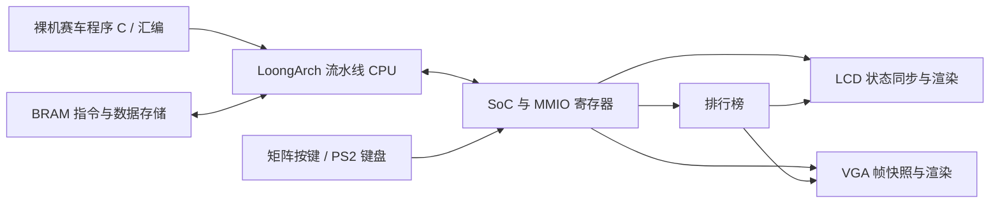

# LoongArch CPU 与 FPGA 赛车系统

基于 LoongArch 32 位 CPU 的课程实践工程，包含单周期 CPU、五级流水线 CPU，以及集成裸机赛车程序、显示和键盘输入的 FPGA SoC。

当前应用主线是 [`final_cpu/`](final_cpu/README.md)。首次访问可先看下面的系统结构与功能入口，再按 [运行说明](docs/GETTING_STARTED.md) 准备环境。

## 项目内容

| 部分 | 内容 | 源码入口 |
| --- | --- | --- |
| CPU | 取指、译码、执行、访存和写回；包含前递、流水控制、CSR、地址转换和乘除法相关模块 | [`final_cpu/rtl/cpu/`](final_cpu/rtl/cpu/) |
| 游戏软件 | 裸机 C 与汇编程序，通过 MMIO 提交赛车状态 | [`final_cpu/sw/game/`](final_cpu/sw/game/) |
| 显示与输入 | LCD 初始化与像素渲染、VGA 输出、排行榜、PS/2 键盘和矩阵按键接口 | [`final_cpu/rtl/lcd/`](final_cpu/rtl/lcd/) · [`final_cpu/rtl/soc/`](final_cpu/rtl/soc/) |
| 工程与验证 | Vivado 建工程、仿真和实现脚本，以及 RTL testbench | [`final_cpu/run_vivado/`](final_cpu/run_vivado/) |
| 基础实验 | 独立保留的单周期与流水线实验、golden trace 和对拍环境 | [`cdp_ede_local-master/`](cdp_ede_local-master/README.md) · [`cdp_ede_pipeline/`](cdp_ede_pipeline/README.md) |

目录中已有相应实现与验证入口。测试覆盖范围、复现方式和结果记录的区别见 [验证说明](docs/VERIFICATION.md)。

## 系统结构

软件负责更新游戏状态；显示模块根据寄存器状态生成画面。CPU、总线、软件和外设各自有对应的源码入口，便于按一条完整的数据流阅读。

## 从哪里开始

- **了解项目**：[主工程技术说明](final_cpu/README.md)，包含模块划分和 MMIO 地址表。
- **准备运行**：[环境与运行步骤](docs/GETTING_STARTED.md)，使用实际克隆位置和本机工具路径。
- **查看验证方式**：[仿真范围与结果记录](docs/VERIFICATION.md)，区分现有 testbench 与实际运行结果。
- **准备演示与讲解**：[演示和项目讲解提纲](docs/PROJECT_GUIDE.md)。
- **查找旧命令**：[原始本机操作记录](docs/LEGACY_COMMANDS.md)。

## 环境概要

- Vivado 2019.2；现有建工程脚本的目标器件为 `xc7a200tfbg676-1`。
- Windows PowerShell 用于执行 Vivado 批处理；重新编译裸机程序还需 Linux / WSL、GNU Make、Python 3 和 LA32R 交叉编译工具链。
- 硬件演示需要与约束文件相符的开发板、显示和输入设备。仅运行仿真不需要连接开发板。

## 当前展示状态

- 已整理源码导航、运行入口、测试范围和讲解提纲。
- 仓库尚未附上板照片或演示视频，也未保存可公开核对的时序报告、仿真日志；这些材料列入后续补充清单。
- 本次整理核对了仓库文件和脚本入口，未重新执行 Vivado 仿真、综合或上板操作。

## 工程来源与使用

项目保留了 CDP/EDE 实验环境，以及 Xilinx IP 配置和 LCD DCP 依赖。课程框架、第三方模块和个人修改的范围需要结合原始材料与提交记录说明；具体整理建议见 [项目讲解提纲](docs/PROJECT_GUIDE.md)。

当前仓库未附统一许可证，使用或分发原有代码与第三方文件前应核对各自授权。
